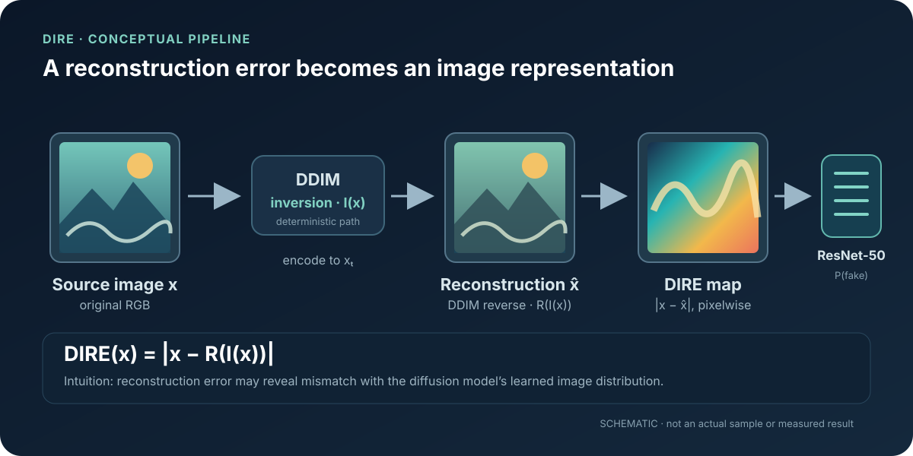
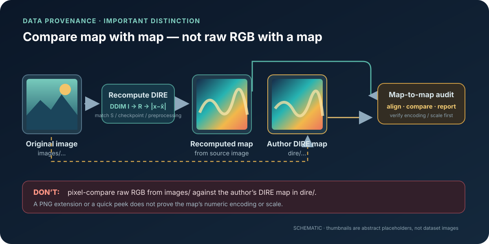
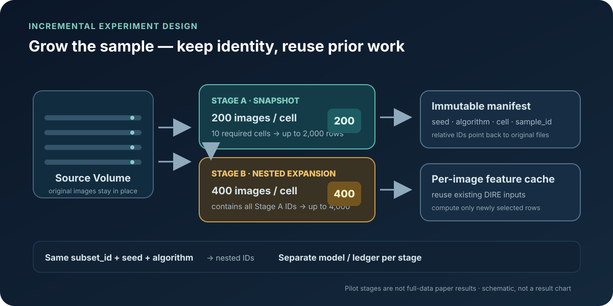
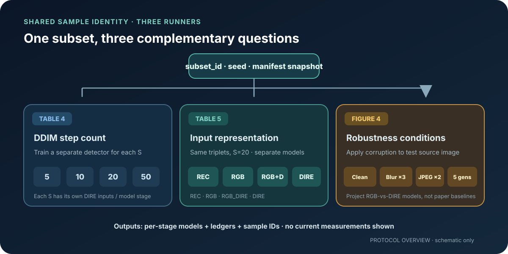

# Brief / prompt cho agent tạo slide: DIRE và pilot subset tăng dần

> **Mục đích:** tài liệu này là gói bàn giao tự chứa cho một agent làm slide khác. Có thể đưa nguyên file này cho agent đó cùng thư mục `docs/slide-assets/`. Tài liệu chứa prompt, luận điểm, protocol, trạng thái, nguồn cần trích và sơ đồ SVG gốc để đưa thẳng vào slide.
>
> **Trạng thái dự án:** subset workflow đã được triển khai và merge vào `main` (merge commit `e7bf633`). Chưa có kết quả GPU Table 4/Table 5/Figure 4 của workflow subset này. Đừng trình bày lệnh/protocol như thể đã chạy hoặc đã tạo ra số đo.

---

## Prompt có thể chuyển nguyên văn cho slide agent

```text
Bạn là một research presentation designer kiêm scientific fact-checker. Hãy tạo một bộ slide tiếng Việt giải thích DIRE và kế hoạch pilot tăng dần dùng cùng subset cho Table 4, Table 5, Figure 4.

MỤC TIÊU / NGƯỜI NGHE
- Người nghe: kỹ sư ML, nhà nghiên cứu thị giác máy tính và người ra quyết định kỹ thuật; hiểu CNN/diffusion cơ bản nhưng không nhất thiết biết DIRE.
- Kể một mạch rõ: bài toán generalization → trực giác và công thức DIRE → cách kiểm chứng đúng nguồn dữ liệu → ba thí nghiệm → thiết kế subset/resume → trạng thái và giới hạn.
- Đầu ra đề nghị: 12 slide chính + tối đa 3 slide appendix; tỉ lệ 16:9; tiếng Việt; có source/citation ở chân slide hoặc speaker notes; xuất PPTX và PDF cùng source editable nếu công cụ hỗ trợ.
- Giữ giọng khoa học, sáng rõ, không quảng cáo. Mỗi slide một luận điểm; ưu tiên sơ đồ, ma trận protocol, hình ảnh được truy nguyên và whitespace. Dùng palette navy/teal/amber trong SVG đính kèm.

LUẬN ĐIỂM KHOA HỌC
- DIRE = Diffusion Reconstruction Error. Với ảnh x, áp dụng DDIM inversion I rồi reconstruction R; biểu diễn là DIRE(x) = |x − R(I(x))|, trị tuyệt đối pixel-wise theo từng kênh. Paper mô tả trực giác: ảnh gần phân phối của diffusion model có thể được tái tạo khác với ảnh nằm ngoài phân phối đó. Đây là trực giác/giả thuyết thực nghiệm, KHÔNG phát biểu như định lý hay dấu hiệu bất khả sai.
- Pipeline khái niệm trong code walkthrough dùng S bước inversion + S bước sampling; paper/repo tác giả có cấu hình tham chiếu S=20 cho một đường chạy. Tính tất định của DDIM là phần quan trọng để cùng input/protocol cho kết quả có thể lặp lại.
- Detector là ResNet-50 với một logit để dự đoán P(fake); báo cả ACC và AP khi có số liệu. Không tráo lẫn score của tác giả, số trong paper và số đo của repo.

CÁC QUY TẮC KHÔNG ĐƯỢC VI PHẠM
1. NGUỒN ẢNH VÀ DIRE MAP KHÔNG PHẢI CÙNG LOẠI DỮ LIỆU: `images/` là ảnh gốc; `dire/` là DIRE map đã tính của tác giả. Nếu trình bày so sánh implementation, hãy lấy ảnh gốc, tính lại DIRE theo protocol đã chốt rồi so map được tính lại với map DIRE của tác giả. KHÔNG so pixel RGB ảnh thô với pixel DIRE map.
2. Không suy ra encoding/scale của map PNG chỉ từ phần mở rộng, màu hiển thị hoặc một lần `peek`. Xác minh metadata/source encoding trước khi decode; không tự bật `--image-map-encoding linear-0-2` nếu chưa được chứng minh.
3. Không tạo ảnh giả, DIRE map giả, ROC/PR/AP chart giả, confidence interval giả hoặc kết quả Table 4/5/Figure 4 chưa chạy. Các SVG đính kèm là SƠ ĐỒ MINH HỌA, không phải output thực nghiệm hay ảnh dataset.
4. Nếu cần ảnh dataset thật, chỉ dùng cặp đã được cấp phép và truy nguyên được: ảnh gốc + map tương ứng; ghi nguồn/ID/hash và chú thích. Repo hiện không có ảnh sample thật của DIRE để gắn vào slide. Nếu chưa có cặp đã xác minh, dùng SVG đính kèm thay vì hình ảnh photorealistic sinh bằng AI.
5. Phân biệt rõ `paper-reported` với `repo-measured`. Có thể dùng số Table 2 của paper, nhưng phải gắn nhãn trực tiếp “số của tác giả, ICCV 2023 — không phải số của dự án”. Không có metric đo của subset workflow Table 4/5/Figure 4 để trình bày lúc này.
6. Table 4/5/Figure 4 hiện dùng generator test LSUN `sdv2`; không gọi đó là `sdv1` hoặc đồng nhất với một archive khác.
7. Figure 4 implementation hiện là so sánh RGB ResNet-50 của dự án với DIRE ResNet-50; chưa tái tạo baseline CNNDetection*/PatchForensics* của paper. Runner tính lại DIRE sau corruption. Ghi đây là protocol của implementation hiện tại, không tuyên bố exact reproduction của Figure 4 paper.
8. Paper/data phát hành là nguồn ảnh; tự tính DIRE map + tự train detector trên ảnh đó tương ứng provenance R1+R2, không phải R3. Chỉ ghi R3 nếu ảnh cũng do dự án tự sinh theo protocol và provenance cho phép.
9. Không hàm ý pilot subset là kết quả full-data. Snapshot mặc định seed 3407; 200 ảnh/cell trên 10 cell cho tối đa 2.000 hàng. Mốc 400/cell tối đa 4.000 hàng và lồng mốc 200/cell nếu giữ subset_id + seed + thuật toán.
10. Không tuyên bố cache author DIRE map luôn đủ cho Table 5: representation REC cần reconstruction; cache `.npy` residual không nhất thiết lưu đủ dữ liệu để dựng REC.

THÔNG TIN PROTOCOL ĐÃ CHỐT TRONG REPO
- Subset là manifest/index bất biến trỏ tới ảnh gốc trên Modal Volume; không copy hay chỉnh sửa ảnh nguồn. Lưu `sample_id` tương đối, seed, thuật toán `sha256-ranked-cell-v1`, cell, số hàng, base manifest SHA-256 và provenance.
- 10 cell hiện tại: train real/ADM; val real/ADM; test real và ADM/DDPM/iDDPM/PNDM/SDv2. `per_cell=200` cho 2.000 hàng nếu đủ mẫu ở mọi cell; cell thiếu chỉ lấy toàn bộ.
- Tạo snapshot trước khi chạy experiment. Mỗi stage có model/ledger riêng; model ở stage 200 không được mô tả là resume weights của stage 400. Table 5 có cache input tăng dần trong cùng run ID, nên ảnh/representation đã materialize có thể được dùng lại; stage lớn bổ sung mẫu mới.
- Snapshot lưu tại `/zero/subsets/<subset_id>/per-cell-NNNNNN.json`; protocol ở `_protocol.json`. Table 4, Table 5 và Figure 4 nhận cùng `subset_id`/`per_cell`; namespace stage subset tách khỏi full-data.
- Table 4: S ∈ {5, 10, 20, 50}; detector train riêng trên ADM và chấm từng generator test.
- Table 5: S=20, representations REC, RGB, RGB_DIRE, DIRE; train/evaluate riêng. Runner mặc định ImageNet-initialized ResNet-50, 400 epochs, batch 32, lr 1e-4, crop 224; đây là cấu hình runner trong repo, không khẳng định mọi chi tiết là exact paper protocol.
- Figure 4: clean, blur σ=1/2/3, JPEG q=65/30; điểm AP theo từng generator. Test rows dùng phần test của đúng subset; cần Table 5 RGB và DIRE model của đúng stage.
- Pilot output gắn `subset_status=pilot`; full-data chỉ khi snapshot bao phủ toàn bộ row hiện có theo protocol. Công cụ dựng bảng mặc định từ chối coi pilot là full-data.
- Một snapshot 200/cell tương đương 2.000 ảnh tối đa và stage 400/cell tương đương 4.000 ảnh tối đa; số thực tế lấy từ ledger/snapshot, không thay bằng số giả định trên hình.

SLIDE STORYBOARD ĐỀ XUẤT (12 SLIDE)
1. **Title / câu hỏi:** “Ảnh có thể được nhận diện qua cách nó tái tạo ra sao?” Subtitle: DIRE — Wang et al., ICCV 2023; tách tên bài báo khỏi trạng thái dự án.
2. **Bài toán:** phát hiện ảnh thật/ảnh sinh khi generator ở test khác generator train (domain shift). Dùng sơ đồ domain train → unseen test, không cần ảnh giả.
3. **Trực giác:** một diffusion model cung cấp một phép tái tạo; độ lệch reconstruction có thể là representation hữu ích. Nói rõ trực giác cần kiểm chứng, không phải định luật.
4. **Công thức/pipeline:** x → DDIM inversion I → x_T → reconstruction R → x̂ → |x−x̂| → detector. Dùng `dire-pipeline.svg`.
5. **Đối chiếu đúng map/provenance:** ảnh gốc `images/` → tự tính DIRE → so map đó với author map `dire/`; nhấn đỏ việc không so RGB thô với map. Dùng `map-provenance.svg`.
6. **Từ map tới quyết định:** representation đi vào ResNet-50, một logit → P(fake); phân biệt ACC (ngưỡng) và AP (ranking). Không tự vẽ điểm số.
7. **Paper evidence, nếu cần:** có thể trích Table 2 của paper theo `src/dire_modal/paper_table2.tsv`; mọi con số phải ghi “paper-reported”. Nếu không cần slide số liệu thì thay bằng sơ đồ phương pháp; tuyệt đối không gọi là kết quả của repo.
8. **Ma trận thí nghiệm:** Table 4 thay S; Table 5 thay representation; Figure 4 thay corruption. Dùng `experiment-map.svg`; caption nhắc test generator hiện tại là SDv2.
9. **Thiết kế subset tăng dần:** 200/cell → 400/cell; 10 cell; manifest/index, không copy ảnh; ID lồng nhau; cache per-image. Dùng `nested-subsets.svg`.
10. **Tính an toàn / provenance:** cùng sample IDs giữa ba runner; lock seed, manifest, checkpoint/config; stage model và ledger tách; “pilot ≠ full-data”; sơ đồ đường dẫn artefact nếu cần.
11. **Trạng thái và giới hạn hiện tại:** code subset đã merge; các phép Table 4/5/Figure 4 của workflow subset chưa có kết quả GPU; Figure 4 không có baseline paper; còn phải kiểm dữ liệu/protocol và chạy theo quyền riêng. Không dùng tiến độ job cũ như kết quả hoàn tất khi chưa có xác nhận.
12. **Kết luận / việc tiếp theo:** snapshot trước, xác nhận số row/cell, chạy 2k pilot theo runbook, kiểm ledger/provenance, rồi mới quyết định mở rộng 4k. Kết luận thận trọng: “workflow cho phép thí nghiệm có thể resume”, không nói “đã chứng minh detector”.

Có thể dùng 1–3 appendix slides cho: định nghĩa R0/R1/R2/R3; bảng Table 4/5 parameters; nguồn và quyết định encoding/map. Nếu thêm nội dung beyond storyboard, hãy cite nguồn trong speaker notes.

THIẾT KẾ / OUTPUT
- Ưu tiên 1 ý chính/slide; title là kết luận, không phải nhãn mục lục. Dùng tối đa 3 màu nhấn, font sans dễ đọc, body ngắn; công thức chỉ dùng khi giải thích được bằng lời.
- Tất cả SVG dưới `docs/slide-assets/` là ảnh vector nguyên bản kèm trong gói. Nhúng đúng asset, giữ ghi chú “schematic / not measured”. Có thể chỉnh màu/kích thước, không được biến sơ đồ thành biểu đồ kết quả.
- Cung cấp citation ngắn trên slide và một slide References: Wang et al., “DIRE for Diffusion-Generated Image Detection,” ICCV 2023, arXiv:2303.09295v1; và các nguồn repo nêu bên dưới.
- Xuất bản editable + PDF; nếu dùng AI/ảnh stock cho trang bìa, chỉ dùng abstract background không mô phỏng ảnh/dataset hoặc map thật, và ghi rõ nguồn/giấy phép.
- Cuối cùng tự chạy một fact-check: số nào là paper, số nào là repo, số nào chưa có; mọi con số phải có provenance. Kiểm tra ảnh SVG nhúng và chữ không bị cắt.
```

---

## Hình minh họa đính kèm

Các hình dưới là SVG vector gốc của brief, nhúng trực tiếp để agent có thể xem và tái sử dụng. Thumbnail trừu tượng chỉ là placeholder trực quan, không phải ảnh dataset.

### 1. Pipeline DIRE



### 2. So sánh map có provenance đúng



### 3. Subset lồng nhau, manifest-only và cache tăng dần



### 4. Ba họ thí nghiệm dùng cùng định danh subset



---

## Tạo nhanh ảnh/bảng từ repo

Tạo lại gói SVG + CSV chỉ bằng Python standard library, không cần cài Torch/Matplotlib và không gọi Modal:

```bash
python tools/build_slide_assets.py
# tuỳ chỉnh đường dẫn và stage subset hiển thị:
python tools/build_slide_assets.py --out /tmp/dire-assets --per-cell 200 400 800
```

Mặc định ghi vào `docs/slide-assets/generated/`. Mở `index.html` để xem gallery. Script copy bốn SVG sơ đồ ở trên và sinh các bảng `experiment-protocol`, `table5-representations`, `subset-stages`, `paper-table2-reference`, `status-and-caveats` dưới cả SVG và CSV; `asset-manifest.json` liệt kê nguồn. Số subset là **upper bound theo số cell**, không phải n thực tế; số Table 2 được đọc từ TSV tác giả và gắn nhãn paper-reported. Script không tạo metric thực nghiệm.

## Source packet để agent tra cứu

| Nguồn | Dùng để xác minh |
|---|---|
| [`docs/paper-code-walkthrough.md`](paper-code-walkthrough.md) | Câu hỏi khoa học, công thức DIRE Eq. 9, DDIM, data preprocessing, mapping paper→code và các sai khác đã biết. |
| [`docs/table4-table5-figure4-runbook.md`](table4-table5-figure4-runbook.md) | Protocol, điều kiện Table 4/5/Figure 4, requirements, checkpoint, giới hạn và lệnh runner. |
| [`docs/plans/research/incremental-paper-subsets.md`](plans/research/incremental-paper-subsets.md) | Subset snapshots, seed/algorithm, 10 cells, lồng 200→400, cache/reuse, namespaces và lệnh theo stage. |
| [`docs/plans/research/full-paper-reproduction-plan.md`](plans/research/full-paper-reproduction-plan.md) | Ranh giới khoa học, ma trận tái hiện rộng và tiêu chí hoàn thành. |
| [`docs/full-paper-continuation-runbook.md`](full-paper-continuation-runbook.md) | Inventory, provenance của nguồn dữ liệu, trạng thái cần xác minh và runner roadmap. Các log được ghi là chưa xác minh từ sandbox. |
| [`docs/adr/adr-0006-reproduction-levels.md`](adr/adr-0006-reproduction-levels.md) | Ý nghĩa provenance R0/R1/R2/R3, điều gì được và không được tuyên bố. |
| [`platforms/site/README.md`](../platforms/site/README.md) + [`platforms/site/index.html`](../platforms/site/index.html) | Deck web 12 slide hiện hữu; tham khảo nhịp kể, nhưng đây là pitch deck project khác, không phải nguồn cho số liệu Table 4/5/Figure 4. |
| [`src/dire_modal/paper_table2.tsv`](../src/dire_modal/paper_table2.tsv) | Bảng số Table 2 của tác giả, chỉ dùng nếu được gắn nhãn `paper-reported`. |
| [`src/dire_zero/subsets.py`](../src/dire_zero/subsets.py) + [`src/dire_zero/modal_app.py`](../src/dire_zero/modal_app.py) | Algorithm ID, selection semantics, subset validation, runner/namespace behavior. |
| [`tools/build_slide_assets.py`](../tools/build_slide_assets.py) | Sinh SVG/CSV dùng cho slide và gallery HTML từ protocol, Table 2 TSV và bốn sơ đồ SVG. |

### Số Table 2 (chỉ là số báo cáo trong paper, tùy chọn đưa vào deck)

Tệp nguồn ghi average theo detector: ADM `99.9 ACC / 100.0 AP`; PNDM `98.7 / 100.0`; iDDPM `98.6 / 100.0`; StyleGAN `97.9 / 100.0`. Đây là **kết quả tác giả trong Table 2**, không phải số đo của dự án và không phải kết quả subset. Nếu agent trình bày, phải đặt nhãn ngay trên biểu đồ/bảng và trích dẫn Table 2; không viết “our result”.

### Trạng thái hiện tại / điều chưa biết

- Subset feature đã được code và merge; chưa có bằng chứng ở workspace rằng Table 4, Table 5, Figure 4 đã chạy xong bằng subset mới.
- Thông tin tiến độ cũ `3000/87768` là một log trước đó; không có xác nhận job hoàn tất hay còn chạy. Không biến log này thành progress hiện tại.
- Dữ liệu ảnh thật, author `dire/` maps, checkpoint và Volume nằm ngoài repo; agent làm slide không được giả định đã truy cập được chúng.
- Hiện chưa đính kèm ảnh dataset thật. Bốn SVG ở trên là hình thật của deliverable này, nhưng chỉ là sơ đồ khái niệm.

---

## Gợi ý skill/tool cho slide agent

1. **Research-slide/storyline skill:** viết headline dạng kết luận, dựng narrative 10–12 phút, phân bổ một thông điệp/slide, tạo speaker notes.
2. **Scientific fact-check + citation skill:** kiểm mọi con số và câu claim với PDF/paper/code; thêm inline citation hoặc source note; rà riêng trạng thái paper-reported / measured / not-run.
3. **Data-viz skill:** chỉ vẽ chart khi có dữ liệu ledger/CSV và protocol; không minh họa kết quả bằng dữ liệu mô phỏng. Với hiện trạng, dùng sơ đồ protocol thay chart.
4. **Diagram/SVG skill:** dùng các SVG nhúng làm starting point; tự tạo sơ đồ vector cho DDIM, manifest, experiment matrix; kiểm SVG render trong PPTX/PDF.
5. **Slide production skill:** ưu tiên Marp nếu cần author bằng Markdown nhanh; PptxGenJS nếu cần deck PowerPoint editable và layout chính xác; `python-pptx` là phương án Python-only. Chọn một pipeline có thể xuất PDF và kiểm font/overflow.
6. **Image licensing/provenance skill:** nếu thêm ảnh paper/dataset, kiểm quyền sử dụng, lưu nguồn, caption/hash; không dùng ảnh sinh để giả lập ảnh gốc hoặc DIRE heatmap.

**Gợi ý chọn tool:** deck dùng cho thuyết trình trực tiếp và cần sửa tiếp → PptxGenJS; muốn version-control nội dung/Markdown-first → Marp; cần agent thao tác trực tiếp trên Google Slides thì dùng skill Google Slides hiện có của môi trường agent, nhưng vẫn giữ source packet/citations trong repo. Không upload dữ liệu nghiên cứu hoặc ảnh có hạn chế lên SaaS nếu chưa xác nhận quyền chia sẻ.
